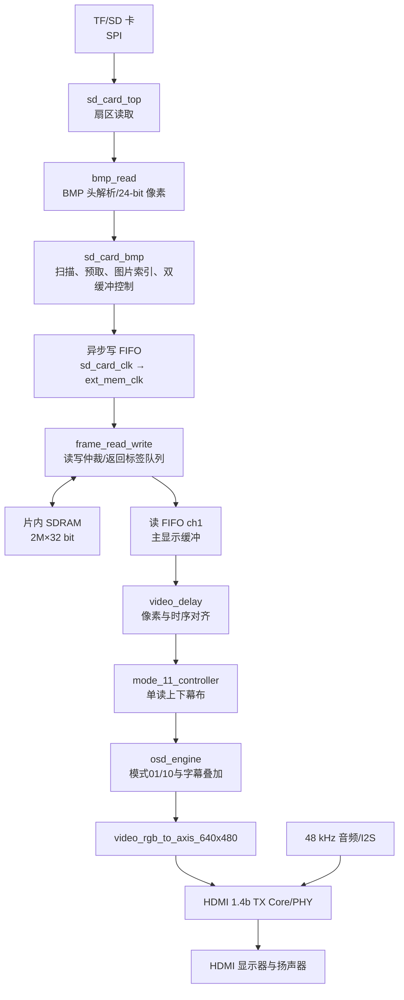

# Codex 搜集到的资料

> 最后更新时间：2026-10-08 11:19（Asia/Shanghai）  
> 调查范围：2026 FPGA 创新设计赛道公开资料、本地 `fpga资料`、当前 `E:\Codex\5` 工程源码与构建报告  
> 参赛目标：**国家二等奖保底，国家一等奖冲刺**  
> 证据标记：**官方明确要求**、**Codex 分析**、**合理推断，不是官方原文要求**、**待确认**。

## 一、本次 FPGA 大赛基本信息

### 1.1 赛事身份

| 项目 | 已核实信息 |
| --- | --- |
| 大赛完整名称 | 第九届（2026）全国大学生嵌入式芯片与系统设计竞赛——FPGA 创新设计赛道 |
| 当前赛题 | 上海安路科技赛题一：**基于安路 EG4S20 的 HDMI 多媒体播放系统** |
| 指导单位 | 中国电子学会 |
| 主办单位 | 中国电子教育学会 |
| 承办单位 | 东南大学、南京市江北新区管理委员会 |
| 官方信息网站 | [全国大学生嵌入式芯片与系统设计竞赛官网](https://www.fpgachina.cn/) |
| 报名入口 | [竞赛报名平台](https://www.socchina.net/) |
| 赛题官方页面 | [安路科技 2026 FPGA 赛道选题指南](https://www.anlogic.com/support/university/competitions/eda/news1/42.html) |
| 赛题官方文件 | [安路官方 PDF](https://www.anlogic.com/Public/Uploads/ueditor/upload/file/20260826/1787734941769836.pdf)；本地副本：`E:\Codex\fpga资料\赛题.docx` |

本地 `赛题.docx` 的标题、正文与安路官网 2026-08-26 发布的赛题指南一致。其 Office 元数据记录创建时间为 2026-08-24，可作为离线官方赛题副本使用。

### 1.2 时间与阶段

| 阶段 | 时间 | 状态（截至 2026-10-07） |
| --- | --- | --- |
| 通知与报名 | 2026-07-06 至 2026-09-22 24:00 | 已结束 |
| 作品设计 | 2026-09 至 2026-11-04 | 进行中 |
| 作品提交截止 | **2026-11-04 18:00** | 尚未截止 |
| 全国总决赛 | **2026-11-20 至 2026-11-22** | 待举行 |
| 决赛地点 | 江苏省南京市江北新区 | 具体地点和方式待后续通知 |

### 1.3 参赛要求

- 国内高校相关专业在校高职高专学生、本科生和研究生可参赛。
- 每队不超过 3 名学生、不超过 2 名指导教师；每名学生限参加一支队伍。
- 资格审查关注报名信息完整度、创新性、科学性、工程可行性、设计难度和 FPGA 平台适用度。
- 当前队伍资料：本科组，队号 47610，队名“完全队”，作品名“万象屏”，自备安路平台；详见 `E:\Codex\fpga资料\FPGA竞赛调研\本队报名信息.md`。

### 1.4 比赛流程、演示与答辩

2026 已明确的流程：

1. 报名与资格审查。
2. 提交作品报告、视频等材料，参加线上初赛。
3. 晋级队伍参加现场决赛。
4. 决赛包含 FPGA 基础编程设计能力考核；**通过该测试才获得决赛评奖资格**。
5. 现场评审包括作品介绍、实物演示和专家提问。
6. 评审公开维度包括完整度、专业性、创新性。

截至 2026-10-07 仍为 **待确认**：

- 2026 完整提交物清单、文件命名、格式、大小限制、视频时长及匿名要求。
- 2026 源码包、工程文件、承诺书和授权书的准确模板及要求。
- 现场演示时长、展位条件和设备清单。
- 能力考核时长、题型、分值、是否允许查资料或联网、是否要求实操上板。
- 初赛和决赛评分表、各维度权重、国一与国二分数线。

往届规则只能用于提前准备：2024 曾要求介绍视频、PDF 报告、重要代码、承诺及授权书、作品照片和团队合影，视频建议 3 分钟内且 300 MB 内；2025 决赛曾要求现场演示不超过 5 分钟、画面不出现学校信息、能力测评自备电脑。**这些不是已确认的 2026 硬要求。**

### 1.5 奖项和评分公开信息

- 全国一等奖不超过 100 个、二等奖不超过 200 个，三等奖酌情设置。
- 最佳创意奖、最佳工程奖各不超过 3 个且允许空缺，从一、二等奖队伍中评选；候选队伍需参加汇评。
- 企业特别奖由协办单位独立评选。
- 赛题一的基础评分项为：核心功能完整性、显示稳定性与鲁棒性、基础音频输出、系统工程规范性。
- 赛题扩展项不设置公开的固定单项分值，综合考察完成数量、技术难度、实现质量、系统稳定性和现场展示效果。

2025 安路平台公开数据可用于判断竞争强度：FPGA 赛道共 342 所院校、3901 队报名、1855 队提交；安路平台 896 队报名，提交率 54.1%，最终一等奖 24、二等奖 46、三等奖 123，另有最佳创意奖 1、安路科技杯 2。按公开数估算，安路平台约 485 队提交，一等奖约占提交队伍 5.0%，一、二等奖合计约 14.4%。**这是所有安路赛题和组别的汇总，不能当作 2026 赛题一或本科组获奖概率。**

## 二、赛题一官方要求

### 2.1 官方明确要求

#### 平台与设计方向

- 指定/推荐核心平台为 HX4S20C，主芯片 EG4S20BG256。
- 官方列出的器件资源：19,600 LUT、19,600 触发器、片内 SDRAM 2M×32 bit、4 个 PLL、16 路全局时钟、最多 193 个用户 IO。
- 以音视频融合为方向，自主设计具有明确应用场景的多媒体展示系统。
- 系统应体现 FPGA 的并行处理、实时控制、低延迟显示、音画同步和多源信息融合能力，并达到稳定运行与良好现场演示效果。
- 官方列举的实现内容包括但不限于：本地图像扫描、BMP 解析、SDRAM 帧缓存管理、HDMI 视频、HDMI 音频、交互控制、音视频联动。
- 所有展示算法、控制逻辑和数据处理流程必须在 FPGA 中自主编程实现。允许外围电路或成品模块，但不得使用额外处理器辅助控制或算法预处理。
- 复杂系统允许使用多块同款 FPGA 板卡，通过自定义链路组成主从系统。

#### 基础项

官方评分口径给出的四类基础项：

1. 核心功能完整性。
2. 显示稳定性与鲁棒性。
3. 基础音频输出。
4. 系统工程规范性。

官方参考例程进一步明确了基础闭环的典型形态：

- `lab_ex_4`：SD/TF 图片读取、SDRAM 帧缓存、HDMI 显示、按键手动切图、自动轮播。
- `lab_ex_5`：640×480、24 位 RGB 非压缩 BMP，HDMI_B 显示，手动/自动切图与 HDMI 测试音。

老师直播材料把基础演示拆成四项：TF 卡 BMP→SDRAM→HDMI、手动/自动切图、48 kHz HDMI 测试音、上电稳定运行。该表述与官方方向一致，但直播材料本身不是正式规则文件。

#### 扩展项

1. 图层叠加与字幕：播放时叠加时间戳、标语等动态文字，并探索多图层混合和平滑滚动。
2. 图片切换与转场：淡入淡出、滑动等效果，切换过程画面连续。
3. 图片缩放适配：读取不同分辨率图片并适配 HDMI 输出分辨率，鼓励优化缩放质量。
4. 实时调节与信息叠加：使用板载开关/按键调节亮度、对比度等参数，并通过 OSD 显示变化信息。
5. 音频可视化与自主创意：由音频数据生成频谱或波形并叠加到画面，也可扩展其他多媒体功能。

官方给出的扩展评分原则：稳定完成 1 项可获得一定分值；完成 2 项且效果良好可获得扩展部分一半以上分数；完成 3 项及以上且完成度高可获得较高分；高完成度且创新突出可接近满分。最终还看难度、质量、稳定性和现场效果。

#### 自备演示设备

三选一：

- 支持 HDMI 音视频输入的显示与发声一体设备；
- HDMI 显示器加外接音箱；
- HDMI 转 VGA/音频转换器，加 VGA 显示器和音箱。

当前登记设备是 Aigo 15.6 英寸 HDMI 显示器并带扬声器，符合第一种演示方案，仍需在赛前做长时间兼容性验证。

### 2.2 Codex 对赛题的理解

赛题核心不是“把 BMP 显示出来”，而是用纯 FPGA 构建一个可上电独立运行、长期稳定、音视频完整、具有清晰应用场景的多媒体播放系统。评委能够直接看到的画面质量只是结果；背后真正能体现技术含量的是 SD 卡解析、帧缓存管理、跨时钟域、存储仲裁、无撕裂切换、视频实时处理、音视频时序和工程验证方法。

对当前作品“万象屏”，最合适的叙事是：在资源受限的 EG4S20 上实现纯硬件图片媒体管线，并通过双缓冲、多时钟域流控、OSD 和连续转场形成稳定的嵌入式信息展示终端。现场应同时证明功能、稳定性和工程方法，例如展示长时间运行统计、切图次数、FIFO 欠载计数、时序收敛结果、资源和延迟数据。

### 2.3 合理推断

以下内容均为 **合理推断，不是官方原文要求**：

- 基础功能全部可运行只代表具备完赛条件；若存在偶发花屏、上电失败或时序负裕量，很难形成“国二保底”。
- 现有字幕加多模式转场比继续堆大量浅功能更有价值，前提是每种模式可重复运行、无撕裂、无雪花并有验证数据。
- 国一等奖更需要 1～2 个可量化且现场可复测的技术亮点，而不是只增加视觉效果数量。
- 缩放、音频可视化、低延迟或低功耗都可能成为亮点；其中应优先选择能与现有图像管线自然结合、风险可控的功能。
- 评委大概率会追问：为何使用双缓冲；如何保证读写不冲突；SDRAM 刷新/仲裁如何处理；跨时钟域如何证明安全；音画如何同步；转场期间如何保证像素和坐标对齐；最差时序余量为何只有 0.101 ns、约束是否完整。

### 2.4 老师直播图片逐图核对（备赛指导，不等同于官方硬要求）

本节已逐张核对 `E:\Codex\fpga资料\老师直播建议` 下全部 11 张图片。直播材料与正式赛题方向高度一致，但其中的实现建议、接口说明和评测经验应标为老师指导，不能擅自提升为组委会规则。

| 图片 | 直播中的关键信息 | 对当前工程的意义 |
| --- | --- | --- |
| `选题1的硬性要求.png` | 将基础落地拆成 TF 卡 BMP→SDRAM→HDMI、手动/自动切图、48 kHz HDMI 测试音、上电稳定运行；强调 HX4S20C | 当前功能已覆盖，但“稳定运行”仍缺长稳和时序闭环 |
| `赛题的扩展要求.png` | 五类扩展项；至少 1 项，完成项越多、质量越高得分越高 | 当前有字幕和转场，缩放、参数调节、音频可视化仍可扩展 |
| `评测红线要牢记.png` | 平台限定、最终设计固化上电运行、基础与扩展形成单一完整设计、强调实用、自主扩展和优化；列出三种演示设备方案 | “必须固化、单一镜像、优化/低功耗导向”目前只确认来自直播材料，需与后续正式通知交叉核验 |
| `核心数据.png` | EG4S20BG256：19,600 LUT、19,600 触发器、2M×32 bit 片内 SDRAM、4 PLL、16 全局时钟、最多 193 IO、64 块 9Kb RAM、16 块 32Kb RAM | 与当前器件和资源分析一致 |
| `不同基础的上手.png` | 平台可形成“素材读取→解析→帧缓存→HDMI 音视频输出”完整架构；例程降低完赛门槛；进阶方向包括音视频联动、交互、图文叠加、频谱和多源融合；板上有两组 2×20 DC3 与最多 72 组扩展 IO | 说明单纯复现例程区分度有限，应在稳定闭环上形成自己的技术亮点 |
| `技术支持与参考例程.png` | `lab_ex_2026_nosoft` 提供工程、IP 核、数据手册和原理图；`lab_ex_4` 覆盖图像链路，`lab_ex_5` 在其上增加 48 kHz HDMI 音频 | 后续应对照原例程确认公共链路，不应把例程本身包装成创新 |
| `扩展部分的实现思路.png` | OSD 可用 Alpha 混合、字模/图标 ROM；转场建议 SDRAM 双缓冲；缩放建议双线性插值；亮度/对比度采用参数寄存器并 OSD 回显；音频可视化建议 I2S→PCM→FFT/DFT→频谱/波形→RGB 叠加；12.288 MHz 音频时钟配合 ACR 做同步 | 与当前双缓冲、OSD 和音频架构直接相关；缩放与音频可视化是高价值后续方向 |
| `外设接口.png` | 两路 HDMI 输出、12 位 VGA、HDMI 携带音频；QSPI Flash 16 MB、SPI Flash 64 MB、TF 卡；USB-B 下载调试、50 MHz 晶振、USB 供电；关键链路是 TF→SPI→片内 SDRAM→HDMI 音视频 | 当前只使用其中一部分接口；后续功能不要无目的扩展外设 |
| `IP核.png` | 参考 IP/文档：SDRAM Local Bus `APUG010 v1.1`、高性能 SDRAM ERAM `APUG011 v1.2`、HDMI 1.4b TX `APUG092 v1.0`、Soft FIFO `IPUG012` | 排查 SDRAM/FIFO/HDMI 告警与接口时，应优先查这些厂商手册 |
| `lab4--实现基础要求1,2,4.png` | SD/TF SPI 读原始 BMP 字节，解析 640×480/24-bit RGB，写 FIFO 跨域后进入 SDRAM，读 FIFO按显示时序输出；KEY2/KEY4 经消抖控制切图/轮播；强调数码管 50 MHz、SD 100 MHz、HDMI 125 MHz 三类时钟及 FIFO 跨域 | 当前工程实际还细分 25 MHz 像素域和 125 MHz HDMI 串行域，应以实际 RTL/STA 为准；按键映射与当前 key1/key2 逻辑一致 |
| `lab5--加入音频实现音画同步.png` | 在 lab4 上增加 I2S，产生 48 kHz 测试音，与视频复用 HDMI；难点是音频时钟与像素时钟对齐，避免漂移；建议先稳定图像，再加音频，用计数器验证正弦波并校准同步，最后再做可视化 | 当前工程顺序基本符合该路线，但还缺音频频率和同步的量化验证 |

从这些直播图片得到的直接优先级是：先保证 lab4 图像链路稳定，再验证 lab5 音频与同步，之后才做缩放、实时参数或音频可视化。该顺序与当前 P0→P1→P2 路线一致。

## 三、赛题一评分与拿奖分析

### 3.1 分层判断

| 水平 | 典型状态 | 当前工程对应判断 |
| --- | --- | --- |
| 最低基础要求 | TF/SD 读取 BMP，SDRAM 缓存，HDMI 图像与基础音频，手动/自动轮播，上电能运行 | 功能链路与当前时序已闭环，仍缺充分板级长稳证据 |
| 普通完赛 | 基础功能较完整，有 1 个扩展项，但验证浅、偶发异常或演示叙事弱 | 当前字幕、OSD、三类转场已超过单一扩展项；模式 11 花屏历史必须用最新 bit 板测消除疑点 |
| 国奖竞争 | 基础链路稳定，至少 2 个扩展项做深，现场展示完整，源码/报告/验证证据规范 | 已有功能覆盖、事件仿真和 STA 证据，尚缺板级高次数/长稳和量化指标 |
| 国一冲刺 | 有可复测创新点，架构和验证扎实，问答能解释关键取舍，演示零失误 | 仍需形成明确主创新、量化成果和可重复验证材料 |

### 3.2 国二保底前必须形成的证据

1. 当前最终 bitstream 在目标板和目标显示器上的实际验证，而不是只看 RTL 或仿真。
2. 模式 00/01/10/11、手动切图、自动轮播、字幕、音频均通过连续回归。
3. 重点进行数百至数千次切换、至少数小时运行、反复上电和 SD 卡异常恢复测试，并记录故障次数。
4. 保持每次构建 setup/hold 都通过；当前 routed STA 为 setup WNS +0.101 ns、hold WNS +0.003 ns，余量较小，不能以“已经生成 bit”代替检查最终报告。
5. 形成一套统一提交包：工程、源码、约束、bit、图片制作说明、测试数据、报告、视频脚本、演示脚本和回退版本。
6. 准备基础编程能力考核，避免作品优秀却因能力测试未通过而失去评奖资格。

### 3.3 国一与国二之间可能的差距

- **稳定性的证据强度**：国二可以靠稳定完成度竞争；国一通常需要让评委相信系统在压力下仍可靠。
- **技术闭环**：不仅展示效果，还说明算法、缓存、仲裁、CDC、时序和资源之间的设计关系。
- **创新可量化**：例如转场零撕裂、连续切换 1000 次零异常、固定端到端延迟、缩放质量指标、功耗对比。
- **应用场景完整**：字幕、转场、音频、交互应服务于“信息展示终端”叙事，而不是孤立特效。
- **答辩可解释性**：每个亮点都应能用框图、波形、时序报告和现场操作回答“为什么这样设计、怎样验证”。

### 3.4 高收益与低收益创新

高收益：无撕裂双缓冲及压力测试、不同分辨率高质量缩放、音频驱动可视化、可观测的可靠性诊断、低延迟/低功耗优化及前后数据对比。

低收益：继续增加多个相似转场、只改变字幕颜色、复杂菜单但没有核心处理、无法稳定演示的高风险算法。此判断属于 **Codex 分析**。

## 四、我的当前工程分析

### 4.1 工程边界与实际编译入口

- 当前分析对象：`E:\Codex\5`。
- 顶层模块：`top`，文件 `E:\Codex\5\src\user_source\hdl_source\top_tf_hdmi_audio.v`。
- Tang Dynasty 工程：`E:\Codex\5\src\td_project\HDMI1.4b_Transmitter_v1.0.al`。
- 约束：`E:\Codex\5\src\user_source\constraints_source\pin.adc`、`timing.sdc`。
- `.al` 已实际引用当前 `5` 下的 `top_tf_hdmi_audio.v`、`osd_engine.v`、`mode_11_controller.v`、`SD/bmp_read.v`、`SD/frame_read_write.v`、`SD/sd_card_bmp.v`、`SD/sd_card_top.v` 以及两份约束文件，没有在这些关键条目中发现指向 `4`、`4 - 副本` 或 `teacher` 的路径。
- 最新 bit：`E:\Codex\5\src\td_project\HDMI1.4b_Transmitter_v1.0_Runs\phy_1\HDMI1.4b_Transmitter_v1.0.bit`，生成时间 2026-10-07 22:52:42，SHA-256 为 `B7DA6EE91E7976942B0E6A4065E3B9522B036E4DF4E3654082275B154185641E`。

### 4.2 整体数据流

四种模式当前都只从 ch1 取可见图像。模式 11 用 `pixel_y` 生成上下黑幕：先遮住旧图，整屏全黑时翻转 `disp_buf_idx`，保护 4 帧后再打开并露出 ch1 中的新图。ch2 基础设施为接口兼容保留，但模式 11 的预取和消费使能恒为 0。

### 4.3 主要模块、信号与职责

| 文件 / 模块 | 时钟域 | 核心信号 | 当前作用 |
| --- | --- | --- | --- |
| `top_tf_hdmi_audio.v` / `top` | 多时钟域 | `key1,key2,sw1,sw2`、`video_read_req*`、`disp_buf_idx`、`mode11_*` | 顶层连接 PLL、SD、帧缓存、视频、OSD、音频、HDMI 和数码管；模式位序固定为 `{sw2,sw1}` |
| `SD/sd_card_bmp.v` / `sd_card_bmp` | `sd_card_clk` 100 MHz | `key_next,key_auto`、`write_buf_idx,disp_buf_idx`、`fade_start,fade_done`、`transition_mode` | 扫描最多 8 张 BMP，管理首图、下一图预取、手动/自动请求、双缓冲提交及转场握手 |
| `SD/sd_card_top.v` | `sd_card_clk` | SD SPI 命令、扇区地址、数据有效 | SD 卡初始化及扇区级读取；下接 `sd_card_cmd`、`sd_card_sec_read_write`、`spi_master` |
| `SD/bmp_read.v` | `sd_card_clk` | BMP 宽高、像素数据、有效信号 | 解析 BMP 头和像素流，形成写入帧缓存的数据 |
| `SD/frame_read_write.v` / `frame_read_write` | 100/125/25 MHz | `write_req/en/data`、`read_req/en`、`read2_req/en`、`read_pair_ready`、`App_*` | 三个异步 FIFO、SDRAM 读写仲裁、两路显示读请求、返回标签队列；把可变延迟读返回分配至正确读 FIFO |
| `IP/afifo_16_32_256.v` | 100→125 MHz | FIFO 写入/读取、full/empty | 将 16 位 SD 像素流拼成 32 位 SDRAM 写数据 |
| `IP/afifo_32_16_256.v`（两实例） | 125→25 MHz | FIFO 写入/读取、full/empty | 将 32 位 SDRAM 数据拆成 16 位视频数据，分别服务 ch1/ch2 |
| `IP/sdram.v` 及 `include/sdr_*.enc.v` | `ext_mem_clk` 125 MHz + 相移时钟 | `App_req/App_req_ack`、`App_rd_data_valid`、地址/数据 | EG4S20 片内 2M×32 SDRAM 控制和刷新 |
| `SD/video_timing_data.v` | `video_clk` 25 MHz | `hs,vs,de,read_req,read_en,pixel_x/y` | 产生 640×480 视频时序、帧读请求和有效区坐标 |
| `SD/video_delay.v` | `video_clk` | RGB/HS/VS/DE 延迟 | 对齐 FIFO 输出像素和显示控制信号 |
| `mode_11_controller.v` / `mode_11_controller` | `video_clk` | `transition_req,pixel_y,old_pixel,transition_done` | 模式 11 单读控制：ARM 对齐帧边界，RUN 上下幕布每侧每帧 8 行合拢，HOLD 全黑保护 4 帧并开幕；旧 ch2 端口保留但恒禁用 |
| `osd_engine.v` / `osd_engine` | `video_clk` | `mode,fade_start,display_valid,pixel_x/y,bg_pixel` | 模式 01 淡入淡出、模式 10 横向黑幕、字幕背景和滚动文字叠加；模式 11 由外部控制器接管 |
| `font_rom.v`、`osd_text_cell` | `video_clk` | 字符/像素索引 | 生成底部字幕字模 |
| `video_rgb_to_axis_640x480.v` | `video_clk` | RGB/DE/HS/VS → AXI Stream | 将并行视频送入 HDMI 核 |
| `hdmi_1_4b_transmitter_core_wrapper.enc.v`、`hdmi_phy_warpper.v` | 25/125 MHz | 视频 AXIS、音频、TMDS/DDC | HDMI 1.4b 打包和物理输出 |
| `hdmi_audio_tone_i2s_64fs.v`、`I2S_receiver.v`、`audio_arc_calculate.v` | `audio_mclk`/视频相关域 | I2S、采样、N/CTS | 生成并接收测试音频，计算 HDMI ACR 参数 |
| `SD/seg_decoder.v`、`SD/seg_scan.v` | `clk` 50 MHz | `state_code,trans_state_dbg,sw1,sw2` | 数码管诊断和模式显示 |

### 4.4 时钟结构与跨时钟域

| 时钟 | 频率 | 主要模块 |
| --- | ---: | --- |
| `clk` | 50 MHz | 顶层输入、复位/数码管扫描、PLL 参考 |
| `sd_card_clk` | 100 MHz | SD 卡、BMP 解析、按键消抖、图片/缓冲控制、写 FIFO 写侧 |
| `ext_mem_clk` | 125 MHz | SDRAM 应用接口、仲裁、写 FIFO 读侧、两路读 FIFO 写侧 |
| `ext_mem_clk_sft` | 125 MHz 相移 | SDRAM 物理接口 |
| `video_clk` | 25 MHz | 640×480 视频时序、读 FIFO 读侧、转场、OSD、HDMI 视频输入 |
| `hdmi_5x_clk` | 125 MHz | HDMI 串行相关逻辑 |
| `audio_mclk` | 报告为 12.295 MHz | I2S 测试音和音频相关逻辑 |

主要 CDC：

- 像素数据通过异步 FIFO 在 `sd_card_clk→ext_mem_clk` 和 `ext_mem_clk→video_clk` 间传递。
- `write_finish_toggle` 以 toggle 方式从存储域传回 SD 域。
- `fade_start/fade_done`、开关状态等单比特信号通过多级同步和边沿检测处理。
- `disp_buf_idx` 在顶层进入视频域前有两级同步；索引只使用 0/1，单次只翻转最低位。
- `video_read_req/read_req_ack` 采用保持请求直到 ACK 的方式，避免单周期脉冲直接跨域；第二通道握手结构仍存在，但单读模式 11 不再启动它。
- `timing.sdc` 把主时钟组设为异步，故 CDC 正确性主要依赖 RTL 结构和 FIFO IP；需要用 CDC 清单和仿真继续验证，不能仅凭 false path 宣称安全。

### 4.5 SDRAM、FIFO、帧缓存和仲裁

- 分辨率 640×480；一帧 307,200 个 32 位 SDRAM 字地址。
- 当前只使用两个帧缓冲：buffer 0 基址 0，buffer 1 基址 307,200。`disp_buf_idx` 指当前显示，`write_buf_idx` 指预取写入目标。
- `sd_card_bmp` 在首图完成后显示 buffer 0，并把下一张图预取到 `disp_buf_idx ^ 1`。
- 常规转场完成或硬切时翻转 `disp_buf_idx`；随后再把后继图片写入另一缓冲。
- `frame_read_write` 在 SDRAM 侧接受写通道、ch1 读通道和 ch2 读通道请求，用返回标签队列跟踪读数据所属通道。
- 历史双读修复仍保留在 `SD/frame_read_write.v` 和 `top_tf_hdmi_audio.v`，但当前模式 11 控制器把 `read2_prefetch_en/read2_consume_en` 恒置 0，因此 ch2 不请求、不消费，也不再用 `read_pair_ready` 暂停 ch1。
- 2026-10-07 的可执行验证位于 `E:\Codex\5\verification\mode11_curtain_20261007`：ModelSim 事件仿真和 VCD 二次检查确认 `0→9→A→B→0`、单次 `transition_done`、4 帧全黑保护、ch2 全程关闭和 OSD 后叠加。该证据仍不等同于板级通过。

### 4.6 图片读取、切换与按键

图片流程：

1. `sd_card_bmp` 扫描 SD 卡扇区并记录最多 8 张 BMP 的起始位置。
2. `bmp_read` 解析 640×480、24 位非压缩 BMP，并经异步写 FIFO 写入 SDRAM。
3. 首图写完后设 `display_valid`，显示 buffer 0。
4. 空闲时自动把当前图的后继图预取到另一缓冲。
5. `key1` 产生手动下一张请求；`key2` 切换自动轮播开关，自动周期当前为 2 秒。
6. 模式 00 直接翻转显示缓冲；模式 01/10/11 锁存 `transition_mode`，保持 `fade_start`，等待对应控制器返回 `fade_done` 后只翻转一次缓冲。

切图请求队列与模式切换规则（2026-10-08 已更新）：

- `req_cnt` 是上限为 2 的待处理请求计数，表示“当前可执行请求 + 最多一个排队请求”，并非图片编号。
- `{sw2,sw1}` 经两级同步后发生变化时，清除旧模式下尚未开始的排队请求，避免切到新模式后突然连续跳过数张图片。
- 若模式变化时 01/10/11 转场已经开始，则保留一个活动请求，并继续使用锁存的 `transition_mode` 完成该次旧模式转场；完成后计数归零，不把旧队列带入新模式。
- 模式切换不清除已经写好的预取帧，不中断正在进行的 SD/SDRAM 写入；这样避免把系统留在“预取有效状态丢失但缓冲内容无法重建”的半完成状态。
- 模式变化同时重置自动轮播定时器，防止拨码后立即叠加一个旧周期的自动请求。
- RTL 测试覆盖了“00 下堆积两个请求后切 01”和“01 活动转场中切 00”；前者确认旧请求归零且新按键只触发一次 01 转场，后者确认活动转场只提交一次、排队请求被丢弃。证据见 `E:\Codex\5\verification\key_freeze_20261007\mode_change_queue_report_20261008.md`。

快速按键与卡死定位（2026-10-08 已更新）：

- 按键需要稳定按下 20 ms、稳定释放 20 ms 才形成下一次有效脉冲；`req_cnt` 最多保存 2 个请求。因此极快连按会被消抖或队列上限合并，这属于当前交互策略，不保证每一次快速点击都逐张执行。
- 已确认一个能够造成永久不再切图的恢复漏洞：`frame_fifo_write.v` 在 `S_WRITE_BURST` 中若 SD 数据/FIFO 中途断供，会等待旧的 `wr_burst_finish`；上层 2 秒超时后虽然重发 `write_req`，旧状态此前不会接收新请求，导致新请求无 ACK、`pfb_valid` 无法恢复。
- 修复后，`S_WRITE_BURST` 检测到新的同步请求时终止旧 burst，进入 `S_ACK`，复用原有流程清 FIFO、重新锁存地址和长度并完成替代帧。正常传输期间上层不会发出新请求，因此该分支只用于超时重试恢复。
- 先失败后通过的 RTL 测试证明该故障和恢复路径：旧 RTL 报 `FAIL: retry request ignored while writer was stalled`；修复后报 `PASS: stalled frame writer restarts and finishes a fresh request`。测试和完整记录见 `E:\Codex\5\verification\timing_and_key_stall_20261008`。

按键逻辑位于 `SD/sd_card_bmp.v` 内的 `key_press_debounce`：

- `key1`：实物按键 2，图片切换。
- `key2`：实物按键 4，自动轮播开关。
- 输入默认松开为 1、按下为 0；在 100 MHz 域进行两级同步和 20 ms 稳态计数消抖。
- 当稳定状态从松开变为按下时生成一个时钟周期的 `press_pulse`。
- 持续按住不会重复触发；释放后再次稳定按下才会产生下一脉冲。因此没有代码层面的长按连发，但机械输入和板级映射仍需上板核对。

### 4.7 转场、OSD 与字幕

模式位序固定为 `{sw2,sw1}`：

| 模式 | 效果 | 主要实现 | 入口/退出 |
| --- | --- | --- | --- |
| `00` | 硬切 | `sd_card_bmp.v` | 收到切图请求且下一图已预取后直接翻转 `disp_buf_idx`；无转场控制器 |
| `01` | 淡入淡出 | `osd_engine.v` | IDLE 收到锁存为 01 的 `fade_start` 后 ARM；帧边界进入 RUN，旧图逐帧变暗到黑，缓冲切换等待后新图逐帧变亮；HOLD 数帧并发 `fade_done` 后回 IDLE |
| `10` | 横向黑幕 | `osd_engine.v` | ARM 后黑幕从左向右覆盖旧图；全黑阶段请求提交缓冲并等待重填；再从右向左揭开新图，HOLD 后完成 |
| `11` | 上下黑幕开合 | `mode_11_controller.v` | ARM 等帧边界；RUN 时上下黑幕各以 8 行/帧向中心合拢；全黑时只发一次 `transition_done` 让上游翻转显示缓冲；HOLD 全黑保护 4 帧后从中心向上下打开，最终回 IDLE |

模式 11 正常数码管物理第 4 位状态序列是 `0→9→A→B→0`：0=IDLE，9=ARM，A=RUN，B=HOLD。A 不是数字 0 缺段。异常判据包括长期停在 9/A/B、跳过状态、一次转场多次翻转缓冲、进入 A 后整幅横向杂线或 HOLD 后回到旧图。

OSD 位于视频管线后段：底部 `y=460..479` 绘制红色条，内部滚动黑色 16 像素高字模；字幕由 `font_rom.v` 和 `osd_text_cell` 产生。旧实现中，只要双 FIFO 任一路缺数，pair gate 会同时停止两路 FIFO 的 `.re`，但 DE 和坐标仍继续前进，`video_delay` 会把停住的像素重复到后续坐标，形成照片中的密集横线。新实现从模式 11 可见数据路径中移除了 ch2 和 pair gate；幕布仍位于 OSD 之前，因此全黑期间字幕保持可见。花屏是否已在真实板上消失仍需上板确认。

### 4.8 数码管、拨码和诊断

- 物理第 4 位：`trans_state_dbg`，显示转场状态。
- 物理第 6 位：`sw2=mode[1]`。
- 物理第 7 位：`sw1=mode[0]`。
- 物理第 8 位：`sd_card_bmp` 的 `state_code`。
- 模式选择保持 `{sw2,sw1}`，不得在不同模块中重新编码。

### 4.9 当前构建、资源与时序事实

2026-10-08 最新综合资源：

| 资源 | 使用 | 总量 | 利用率 |
| --- | ---: | ---: | ---: |
| LUT | 5,672 | 19,600 | 28.94% |
| 寄存器 | 4,265 | 19,600 | 21.76% |
| BRAM9K | 20 | 64 | 31.25% |
| DSP | 2 | 29 | 6.90% |
| PLL | 3 | 4 | 75.00% |

用户报告的 SWNS -0.024 ns、HWNS +0.003 ns 已核对为当时最新一次完整布局布线结果：`final_timing.rpt` 生成于 2026-10-08 10:33:48，STA coverage 95.31%，setup 仅 1 个失败端点。违例路径位于 100 MHz `sd_card_clk` 域，从 `bmp_read_m0/file_len_reg[17]` 到 `bmp_read_m0/state_reg[4]`；组合路径把 `file_len + 511`、右移 9 位、扫描地址相加和状态判断串在同一拍，共 9 级逻辑、9.744 ns 数据延迟。

`bmp_read.v` 现已在 BMP 头读完时寄存等价的 `ceil(file_len/512)`，后续扫描状态只使用寄存结果。重新完整布局布线后，默认 GUI 配置（seed 关闭、place medium、route normal）setup WNS +0.106 ns、hold WNS +0.003 ns；固定 seed 2、高 effort 的最终推荐结果生成于 2026-10-08 11:10:01，STA coverage 95.20%，全局 setup WNS +0.422 ns、hold WNS +0.019 ns、TNS 均为 0、失败端点均为 0。分时钟 setup/hold 余量：`video_clk` +4.771/+0.019 ns、`sd_card_clk` +0.422/+0.136 ns、`ext_mem_clk` +1.135/+0.037 ns、`hdmi_5x_clk` +4.346/+0.320 ns、`clk` +13.864/+0.428 ns、`audio_clk` +74.613/+0.204 ns。复现脚本为 `E:\Codex\5\verification\key_freeze_20261007\timing_seed2_phy.tcl`。

推荐上板 bit 已归档为 `E:\Codex\5\verification\timing_and_key_stall_20261008\HDMI1.4b_Transmitter_v1.0_timingfix_seed2.bit`，原始生成时间 2026-10-08 11:10:05，SHA-256 为 `7EADF4A077F73E2332EC968E72FB25F156E3A42348C7FF24639CC372FB0D6785`。该 bit 包含时序路径和写通道超时恢复修复；RTL 与布局布线已经验证，真实 SD 卡、按键和长时间运行仍需上板闭环。

综合还报告：部分 SDRAM 加密硬核寄存器 pin 未驱动并被置 0、FIFO/HDMI 内部 RAM 初始化在 `eram_init=off` 时被忽略。这些可能是厂商 IP 的正常告警，也可能影响上电状态；需结合安路 IP 文档和板测确认，不能直接忽略。

## 五、赛题一要求与我的工程对应关系

| 赛题要求 | 当前是否实现 | 对应代码 | 当前完成度 | 风险 | 后续建议 |
| --- | --- | --- | --- | --- | --- |
| HX4S20C / EG4S20 平台 | 是 | `.al`、`top_tf_hdmi_audio.v`、器件报告 | 高 | 无明显平台偏离 | 保持器件和公共硬件框架 |
| SD/TF 本地图像扫描 | 是 | `SD/sd_card_bmp.v`、`SD/sd_card_top.v` | 中高 | 扫描边界、卡兼容性和异常恢复板测不足 | 多品牌/容量/文件布局测试 |
| 640×480 24-bit BMP 解析 | 是 | `SD/bmp_read.v` | 中高 | 非法头、尺寸不符、行填充等边界证据不足 | 建立合法/非法图片测试集 |
| SDRAM 帧缓存 | 是 | `SD/frame_read_write.v`、`IP/sdram.v` | 中高 | 当前 STA 通过，但仲裁、刷新和长时间运行仍需板测 | 保留压力测试和欠载诊断 |
| HDMI 视频输出 | 是 | `video_timing_data.v`、`video_rgb_to_axis_640x480.v`、HDMI 核 | 中高 | 不同显示器兼容性尚未系统记录 | 测试目标屏和备用屏 |
| 手动切图 | 是 | `sd_card_bmp.v` 的 `key1` | 高（代码） | 板级按键映射仍需确认 | 记录消抖和连续操作结果 |
| 自动轮播 | 是 | `sd_card_bmp.v` 的 `key2`、2 秒计时 | 高（代码） | 启停边界和请求队列需回归 | 启停、快速切换、长时间轮播 |
| HDMI 基础音频 | 是 | `hdmi_audio_tone_i2s_64fs.v`、`I2S_receiver.v`、HDMI 核 | 中 | 音画同步只有功能存在，缺量化验证 | 示波/逻辑分析或同步测试素材 |
| 图层叠加与字幕 | 是 | `osd_engine.v`、`font_rom.v` | 中高 | 当前 25 MHz 余量 +1.752 ns，继续叠加组合逻辑会压缩余量 | 保持效果，新增图层前评估流水线 |
| 图片转场 | 是，模式 11 待板验 | `osd_engine.v`、`mode_11_controller.v` | 中高 | 00/01/10/11 事件仿真通过；模式 11 消除双读风险，但尚未上板 | 用最新 bit 做高次数切换和长稳测试 |
| 图片缩放适配 | 未实现 | 无 | 0 | 不同尺寸图片不能高质量适配 | 国一亮点候选，但应在稳定后实施 |
| 亮度/对比度实时调节与 OSD | 未完整实现 | 现有 OSD 可复用 | 低 | 当前拨码已用于模式，交互资源需规划 | 可增加参数页或复用按键长短操作 |
| 音频可视化 | 未实现 | 音频数据链可作为输入 | 0 | 实时频谱资源和时序风险 | 先做低成本柱状能量谱原型 |
| 上电独立稳定运行 | 有 bit，尚未充分验证 | 全工程、最新 bit | 中 | 最终时序通过；上电初始化和长稳测试不足 | P0，必须形成实测记录 |
| 工程规范与可复现 | 部分 | `.al`、约束、测试台、构建产物 | 中 | 缺统一测试报告、版本基线和提交包 | 建版本清单、测试矩阵和一键构建说明 |

## 六、当前工程存在的问题

### P0：比赛前必须解决

1. **最新写通道恢复与模式 11 仍需上板闭环。** 时序路径、写 burst 超时重启、单读上下幕布及模式切换清队列均已通过针对性 RTL、回归、综合、布局布线和时序验证；仍需加载 2026-10-08 11:10 生成并归档的 bit，确认快速按键停止后系统能继续切图、真实屏幕无横线、模式 11 的 `0→9→A→B→0` 每次完整结束。
2. **长时间和高次数测试不足。** 需要数小时自动轮播、数百至数千次手动/自动切换、快速模式切换、反复上电和不同 SD 卡/显示器测试。当前请求队列有意只保留 2 个请求，若比赛交互要求“每次快速点击都逐张执行”，需另行评估队列深度与反馈方式，不能把合并点击误判为卡死。
3. **上电初始化和物理实现告警未解释完。** FIFO/HDMI RAM 初始化被忽略、SDRAM 加密 IP 的 undriven pin，以及 TD 报告的 SDRAM 位置和本地时钟路由 critical warning，需要结合厂商文档和板测确认。
4. **2026 提交细则仍待官方发布/检索确认。** 临近 11 月 4 日必须持续检查官网，避免作品完成却因格式、匿名或材料缺失失分。

### P1：冲击国奖强烈建议解决

1. 建立完整回归矩阵：00/01/10/11、字幕、手动/自动切图、音频、SD 卡异常、显示器热插拔。
2. 给帧读通路增加可观测诊断：FIFO underflow、overflow、丢帧、请求超时、返回标签异常和缓冲冲突计数，并允许数码管/OSD 查看。
3. 把关键 CDC 逐项登记：源域、目标域、同步方法、保持时间和复位行为；对保持型请求与 ACK 做断言或仿真。
4. 优化视频组合路径。当前 `video_clk` setup 余量为 +1.752 ns，字幕坐标、字模和混色仍是后续新增功能的主要时序预算风险。
5. 验证音频的 48 kHz 采样、HDMI 音频稳定性和音画同步，形成可展示的数据而非只听到测试音。
6. 整理单一、可复现的工程基线：源文件清单、工具版本、IP 版本、约束、bit、SD 卡制作脚本、测试图片和已知问题。

### P2：冲击国一的优化项

1. 加入不同分辨率图片的缩放适配，并对最近邻/双线性等方案给出资源、频率和画质对比。
2. 将音频可视化作为音视频融合亮点，优先选择低资源、稳定的频带能量柱状图。
3. 量化端到端切图延迟、转场帧数、SDRAM 带宽余量、FIFO 水位、资源和功耗。
4. 建立故障自恢复：无卡、坏 BMP、超时、FIFO 欠载后自动回到已知稳定帧，并在 OSD 给出状态。
5. 对现有转场形成统一框架和参数化控制，减少重复状态机并提高可解释性；需在稳定版本后进行，避免临赛大改。

## 七、可以增加的创新点

| 优先级 | 创新点 | 难度 | 预计评分收益 | 风险/影响 | 建议 |
| --- | --- | --- | --- | --- | --- |
| 1 | 无撕裂双缓冲 + 欠载检测 + 1000 次切换零异常报告 | 中 | 很高，直接支撑稳定性和工程性 | 需深入读写仲裁与 CDC，但与现架构高度相关 | **推荐优先实现** |
| 2 | 不同分辨率图片缩放，提供画质/资源/延迟对比 | 中高 | 高，直接命中官方扩展项 | 需要行缓存和视频路径时序预算 | **推荐优先实现**，在 P0 清零后开始 |
| 3 | 音频可视化柱状图，并与字幕/转场同屏 | 中 | 高，音视频融合直观 | FFT 风险较高；可先做分频/能量估计 | **推荐优先实现**低复杂度版本 |
| 4 | OSD 诊断页：帧号、图片号、FIFO 欠载、模式、延迟 | 低中 | 中高，利于演示和答辩 | 会增加视频组合路径 | **推荐优先实现**，需加流水线 |
| 5 | 亮度/对比度实时调节并 OSD 回显 | 低中 | 中，命中官方扩展项 | 按键/拨码交互需重规划 | **有时间再实现** |
| 6 | 低功耗或低频优化，给出同画质下功耗前后对比 | 高 | 中高，工程亮点强 | 测量和时序工作量较大 | **有时间再实现** |
| 7 | 再增加更多相似转场 | 低中 | 低 | 回归面扩大，容易引入花屏 | **不建议当前阶段实现** |
| 8 | 复杂 UI/菜单但不增加核心处理能力 | 中 | 低 | 分散调试时间 | **不建议当前阶段实现** |

优先顺序遵循：稳定性 → 官方要求 → 技术含量 → 创新 → 展示效果 → 答辩可解释性 → 回归风险 → 投入产出比。

## 八、后续代码修改原则

以后修改该工程前，先阅读本文档，并同时以实际源码、当前 `.al` 源文件列表和最新构建报告为准。

1. 只在用户指定的可写工程中修改；当前约定是 `5` 可写，`4`、`4 - 副本`、`teacher` 只读。
2. 不为增加功能破坏已稳定功能。任何修改先列影响的时钟域、状态机、缓冲和模式。
3. 优先最小侵入式修复；关键架构变化必须说明必要性、风险和回退路径。
4. 模式位序始终保持 `{sw2,sw1}`；按键定义保持 key1=实物按键2/切图，key2=实物按键4/自动轮播。
5. 公共链路改动必须回归 00/01/10/11、字幕、音频、手动/自动切图。
6. 新增 CDC 必须选择异步 FIFO、toggle、握手或同步器之一，并写清源域、目标域和脉冲保持条件。
7. 所有帧缓冲切换都要证明请求、ACK、地址锁存、首像素和帧边界的对应关系。
8. 生成 bit 不代表完成；必须检查综合告警、布局布线、真实路径 setup/hold、板级结果和长稳结果。
9. 保留真实诊断信息，不把错误状态强行显示成正常值。
10. 每个创新点都应有量化指标、测试方法、现场演示动作和答辩解释。
11. 优先解决真正影响评分的问题；不以功能数量替代完成质量。
12. 总体目标始终是：**在确保现有功能稳定的基础上，把工程逐步打磨到“国家二等奖保底、国家一等奖冲刺”的完成度。**

## 九、网络资料来源

查询时间均为 2026-10-07。正式结论优先采用赛事官网、组委会通知和赛题企业原始文件。

| 资料名称 / 网页标题 | 来源单位 | URL | 发布时间 | 支持的结论 |
| --- | --- | --- | --- | --- |
| 2026 年全国大学生嵌入式芯片与系统设计竞赛 FPGA 赛道选题指南（安路） | 上海安路信息科技股份有限公司 | [网页](https://www.anlogic.com/support/university/competitions/eda/news1/42.html) | 2026-08-26 | 当前安路赛题身份、官方 PDF、赛程和平台背景 |
| 全国大学生嵌入式芯片与系统设计竞赛 2026 年 FPGA 赛道选题指南（安路） | 上海安路信息科技股份有限公司 | [官方 PDF](https://www.anlogic.com/Public/Uploads/ueditor/upload/file/20260826/1787734941769836.pdf) | PDF 未单列日期；挂载页为 2026-08-26 | 赛题一技术要求、基础/扩展评分口径、平台资源、例程和自备设备 |
| 2026 年全国大学生嵌入式芯片与系统设计竞赛——FPGA 创新设计竞赛 | 北京航空航天大学教务部，转发组委会通知 | [网页](https://jiaowu.buaa.edu.cn/info/1016/9028.htm) | 2026-08-31 | 组织单位、组队限制、流程、能力考核、奖项、时间与现场评审；其“两组”属于较早口径 |
| 转发关于邀请参加 2026 年全国大学生嵌入式芯片与系统设计竞赛——FPGA 创新设计赛道的通知（第一轮） | 广东技术师范大学 | [网页](https://gpnu.edu.cn/info/1039/66430.htm) | 2026-09-01 | 高职高专/本科/研究生对象、报名和提交节点，并附组委会原通知 |
| 关于组织参加第九届全国大学生嵌入式芯片与系统设计竞赛 FPGA 创新设计赛道的通知 | 西安邮电大学 | [网页](https://www.xiyou.edu.cn/info/2104/86809.htm) | 2026-08-29 | 三组口径、组队规则和平台事项的交叉验证 |
| 全国大学生嵌入式芯片与系统设计竞赛 2026 | 广东高云半导体科技股份有限公司 | [网页](https://www.gowinsemi.com.cn/university/match2026) | 页面未显示 | 报名截止、提交截止和决赛时间的协办企业交叉验证 |
| 以赛促学，安路科技飞龙平台助力产学研深度融合——2025 年 FPGA 创新设计竞赛精彩回顾 | 上海安路信息科技股份有限公司 | [网页](https://www.anlogic.com/news/company-news/188.html) | 2025-12-05 | 2025 FPGA 赛道和安路平台报名、提交、获奖数据 |
| 赛事官方通知列表入口 | 全国大学生嵌入式芯片与系统设计竞赛组委会 | [官网通知](https://www.fpgachina.cn/inform?value=2) | 持续更新 | 后续核对 2026 提交、决赛、能力测试和答辩通知 |

本地辅助资料：

- `E:\Codex\fpga资料\赛题.docx`：官方赛题指南离线副本。
- `E:\Codex\fpga资料\老师直播建议\老师直播核心内容整理.md` 及配套截图：技术讲解和备赛建议，不能替代官方规则。
- `E:\Codex\fpga资料\FPGA竞赛调研\选题指南精读分析.md`：既有赛题整理。
- `E:\Codex\fpga资料\FPGA竞赛调研\FPGA创新设计竞赛-赛事研究与获奖方法论.md`：既有赛事研究和往届方法论，涉及 2024/2025 的内容需带年份使用。
- `E:\Codex\fpga资料\FPGA竞赛调研\本队报名信息.md`：本队报名与硬件信息。

## 十、资料更新时间与维护规则

**最后更新时间：2026-10-08 11:19**

后续维护：

1. 每次发现赛事官网、组委会或安路发布新通知，更新本文件时间并在来源表增加资料名称、单位、标题、URL、发布时间、查询时间和支持结论。
2. 若新官方资料与本文冲突，以最新官方资料为准，在对应条目写明“**旧信息已更新**”和更新原因。
3. 当前首先追踪：2026 作品上传细则、报告模板、视频要求、决赛安排、演示时长、能力考核规则和评分权重。
4. 工程信息每次以 `E:\Codex\5` 的实际源码、`.al` 和最新构建报告更新，历史结论不得覆盖当前代码事实。
5. “待确认”在获得官方证据前不得改成确定结论；直播建议、往届规则和 Codex 推断必须保留来源标签。

---

### 当前一句话结论

当前工程已经覆盖赛题一基础闭环，00/01/10/11 与字幕完成事件仿真，模式 11 已改为单读上下幕布，并且当前 bit 的 setup/hold 时序均收敛；下一步必须先做模式 11 上板、高次数和长时间稳定性闭环，再投入缩放或音频可视化等国一亮点。
